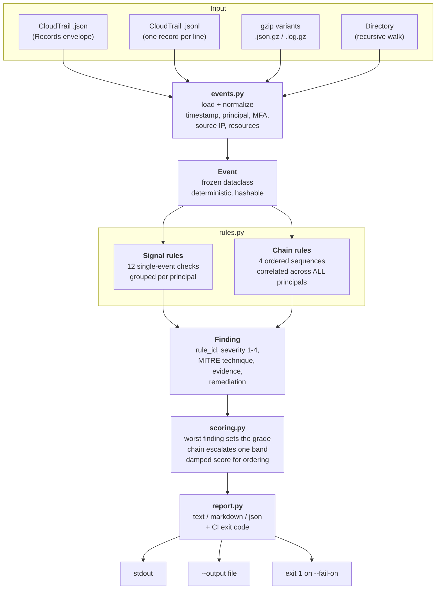

<div align="center">

# trailtriage

**Offline AWS CloudTrail triage for identity-based attacks.**

Single-event signals *plus* time-bounded multi-stage chain correlation. Zero dependencies. No AWS credentials. No network calls.

[](https://www.python.org/)
[](LICENSE)
[](#zero-dependencies)
[](tests/)
[](#detection-rules)

</div>

---

## The problem

A compromised AWS identity does not announce itself with one API call. It looks like this:

```
02:10  iam:CreateAccessKey          <- persistence, boring on its own
02:16  s3:GetObject    x 40         <- the same key draining a finance bucket
02:41  cloudtrail:StopLogging       ...
```

Most CloudTrail tooling either dumps 400,000 JSON lines at you, or fires a Slack alert on every
single `CreateAccessKey` until the channel is muted forever. The signal that actually matters is
the **sequence**, and the sequence is invisible when each event is judged alone.

`trailtriage` reads raw CloudTrail exports and does three things:

1. **Normalizes** every record into one deterministic `Event` shape (root, IAM user, assumed role,
   AWS service, denied calls, MFA state, source IP, resource ARNs).
2. **Scores** each principal with 12 signal rules that catch *what* happened.
3. **Correlates** across all principals with 4 chain rules that catch *the order* things happened
   in, inside a time window you control.

Then it prints a triage queue sorted worst-first, with the exact evidence line and a fix for each
finding. Exit codes make it usable as a CI or scheduled-lambda gate.

---

## Why not just use [existing tool]?

| Approach | What it gives you | Where it stops |
|---|---|---|
| `aws cloudtrail lookup-events` | Raw events, one API at a time | No correlation, no scoring, no triage |
| Athena / OpenSearch over CloudTrail | Powerful ad-hoc queries | Needs a data pipeline, a schema, and a human who knows the query |
| GuardDuty | Excellent managed detections | Managed, opinionated, per-account cost, not tunable or auditable |
| SIEM correlation rules | Flexible | Heavy, needs the SIEM and log onboarding, rules are opaque JSON |
| **`trailtriage`** | Readable, auditable, offline triage of an export | **Not** a real-time streaming detector (see [Limitations](#limitations)) |

`trailtriage` is the tool an incident responder runs *first* on a downloaded export, before
building pipelines. It is intentionally a single command with zero install friction, so it works
in an air-gapped DFIR VM, in CI, and on a laptop at 3am.

### Zero dependencies

Pure Python standard library. No `boto3`, no `pandas`, no `requests`. This is deliberate:

- runs in restrictive IR environments where you cannot `pip install` anything,
- cannot phone home with your CloudTrail data (there is no network code at all),
- cannot break because AWS changed an SDK signature.

---

## Architecture



### The two detection layers

```mermaid
flowchart LR
    subgraph Layer1["Layer 1: signals (per principal)"]
        S1["TRAIL-001 root, no MFA"]
        S2["TRAIL-002 CloudTrail tamper"]
        S3["TRAIL-003 monitoring off"]
        S4["TRAIL-004 IAM persistence"]
        S5["TRAIL-005 MFA removed"]
        S6["TRAIL-006 data made public"]
        S7["TRAIL-007 bulk reads"]
        S8["TRAIL-008 recon sweep"]
        S9["TRAIL-009 denial burst"]
        S10["TRAIL-010 KMS tamper"]
        S11["TRAIL-011 console no MFA"]
        S12["TRAIL-012 guardrail detach"]
    end

    subgraph Layer2["Layer 2: chains (cross-principal, time-bounded)"]
        C1["CHAIN-001<br/>new access key<br/>-> used immediately"]
        C2["CHAIN-002<br/>logging disabled<br/>-> sensitive reads"]
        C3["CHAIN-003<br/>recon sweep<br/>-> IAM write"]
        C4["CHAIN-004<br/>root without MFA<br/>-> credentials created"]
    end

    Events["Normalized events"] --> Layer1
    Events --> Layer2
    Layer1 --> Rank["Ranked triage queue"]
    Layer2 --> Rank
```



**Why the split matters.** Layer 1 catches the individual move. Layer 2 catches the intrusion.
`CHAIN-001` is the one that finds key-swapping: the rule indexes every `iam:CreateAccessKey`
response for the minted key ID, then looks for events **whose `accessKeyId` matches that key**
doing sensitive reads inside the window. That is a cross-principal join: `contractor.dev` mints the
key, `svc-backup` uses it. A per-principal rule physically cannot see it, which is why the chain
engine runs over the whole corpus.

---

## Installation

```bash
git clone https://github.com/mehulpatel23b-pixel/trailtriage.git
cd trailtriage
python -m pip install -e .
```

Or run it straight from the source tree with no install at all:

```bash
PYTHONPATH=src python -m trailtriage /path/to/cloudtrail.json
```

Requires Python 3.9+. Nothing else.

---

## Usage

### A real run

```bash
$ trailtriage examples/cloudtrail-sample.json --top 3
trailtriage - CloudTrail identity attack triage
generated 2026-11-09T03:38:32Z
75 events / 6 principals / 4 flagged / 8 findings

1. [CRITICAL] arn:aws:iam::111122223333:user/contractor.dev
   score 48.5 | 2 finding(s) | type IAMUser
   chains: persistence-to-data-access
   - CHAIN-001 Persistence then data access: fresh access key used immediately [critical] chain:persistence-to-data-access (41 events)
       2026-11-08T02:10:00Z iam:CreateAccessKey minted key AKIAFRES****
       2026-11-08T02:16:00Z s3:GetObject from 203.0.113.45 [ok]
       2026-11-08T02:17:00Z s3:GetObject from 203.0.113.45 [ok]
   - TRAIL-004 IAM persistence primitives used [high] (1 events)
       2026-11-08T02:10:00Z iam:CreateAccessKey from 203.0.113.45 [ok]

2. [CRITICAL] arn:aws:iam::111122223333:role/ops-admin
   score 46.9 | 3 finding(s) | type AssumedRole
   chains: evasion-to-collection
   - CHAIN-002 Defense evasion then data collection [critical] chain:evasion-to-collection (8 events)
       2026-11-08T03:00:00Z cloudtrail:StopLogging from 198.51.100.77 [ok]
       2026-11-08T03:01:00Z guardduty:DeleteDetector from 198.51.100.77 [ok]
       Then 6 sensitive reads by the same principal
   ...
```

Note what the sample proves: the benign `ci-deploy` role made 8 `DescribeInstances` calls and 5
`PutObject` calls from an internal IP and produced **zero** findings. Noise control is a feature.

### Options

| Flag | Default | Purpose |
|---|---|---|
| `path` | *required* | File, `.jsonl`, `.gz`, or directory (walked recursively) |
| `--format` | `text` | `text`, `json`, or `markdown` |
| `--window HOURS` | `24` | Correlation window for chain rules |
| `--min-grade` | `low` | Only report principals at or above this grade |
| `--top N` | `0` (all) | Show only the worst N principals |
| `--fail-on GRADE` | `none` | Exit 1 when any principal reaches this grade (CI gate) |
| `--output FILE` | stdout | Write the report to a file |
| `--quiet` | off | Suppress parse warnings on stderr |

### Common workflows

**1. Triage an export during an incident**

```bash
trailtriage ~/incident/cloudtrail-us-east-1.json.gz --window 6 --top 10
```

Tighten the window to 6 hours to catch a fast intrusion, widen to 72 for a slow one.

**2. Attach a Markdown report to a ticket**

```bash
trailtriage ./trail-export/ --format markdown --output incident-4831.md
```

**3. Feed a SIEM, notebook or Slack bot**

```bash
trailtriage trail.json --format json | jq '.principals[0].findings[].rule_id'
trailtriage trail.json --format json | jq '[.principals[] | select(.grade=="critical") | .principal]'
```

**4. Gate a CI pipeline on suspicious IAM activity in a test account**

```bash
trailtriage ./ci-cloudtrail/ --fail-on high --quiet
```

**5. Daily scheduled job over yesterday's trail**

```bash
aws cloudtrail create-trail ...  # org trail to S3
# then, in the nightly job:
aws s3 sync s3://my-org-trail/AWSLogs/111122223333/CloudTrail/ /tmp/trail/ \
  --exclude "*" --include "*$(date -u -d yesterday +%Y/%m/%d)*"
trailtriage /tmp/trail/ --window 24 --fail-on high --format markdown --output daily.md
```

---

## Detection rules

Severity is 1-4. `Txxx` values are [MITRE ATT&CK](https://attack.mitre.org/) technique IDs.

### Signals

| ID | Rule | Sev | ATT&CK | Fires on |
|---|---|---|---|---|
| `TRAIL-001` | Root activity | 4 / 3 | T1078.004 | Any successful root call; critical when MFA was not used |
| `TRAIL-002` | CloudTrail tampered | 4 | T1562.008 | `StopLogging`, `DeleteTrail`, `UpdateTrail`, `PutEventSelectors`, `DeleteEventDataStore` |
| `TRAIL-003` | Monitoring disabled | 4 | T1562.001 | GuardDuty, Config, Security Hub, VPC flow logs, log group and Access Analyzer deletions |
| `TRAIL-004` | IAM persistence | 3 | T1098 | New users, login profiles, access keys, policy attachments, trust-policy edits |
| `TRAIL-005` | MFA removed | 4 | T1556.006 | `DeactivateMFADevice`, `DeleteVirtualMFADevice`, re-registration |
| `TRAIL-006` | Data made public | 4 | T1530 | Snapshot, bucket, ECR or EFS policy shows `AllUsers`, `AuthenticatedUsers`, `0.0.0.0/0` or `Principal: *` |
| `TRAIL-007` | Bulk sensitive reads | 3 | T1530 | 50+ reads of S3 objects, secrets, SSM params, KMS decrypts in one principal |
| `TRAIL-008` | Recon sweep | 2 | T1526 / T1580 | 25+ distinct `Describe/List/Get/Head` calls across services |
| `TRAIL-009` | Denial burst | 2 | T1069 | 10+ `AccessDenied` / `UnauthorizedOperation` responses |
| `TRAIL-010` | KMS tamper | 3 | T1486 / T1562 | Key disable, scheduled deletion, key-policy change, rotation off, new grant |
| `TRAIL-011` | Console login without MFA | 3 | T1078.004 | Successful `ConsoleLogin` with `mfaAuthenticated=false` |
| `TRAIL-012` | Guardrail detached | 3 | T1562.001 | `DetachRolePolicy`, `DetachUserPolicy`, `DeletePolicyVersion` |

### Chains

Chains run across **all** principals over the `--window` and are escalated one severity band,
because a proven sequence is stronger evidence than a single call.

| ID | Chain | Sev | ATT&CK | Sequence |
|---|---|---|---|---|
| `CHAIN-001` | Persistence then data access | 4 | T1098.001 | `iam:CreateAccessKey` mints key K, then events carrying **key K** do sensitive reads |
| `CHAIN-002` | Defense evasion then collection | 4 | T1562 -> T1530 | Logging or monitoring disabled, then 5+ sensitive reads by the same principal |
| `CHAIN-003` | Recon then escalation | 3 | T1580 -> T1098 | 25+ discovery calls, then an IAM write |
| `CHAIN-004` | Root takeover | 4 | T1078.004 -> T1098 | Root activity without MFA, then credential creation |

CI is not enabled yet on the published repo: the token that created it lacked GitHub's `workflow`
scope. The pipeline is ready in [`ci/github-actions-ci.yml`](ci/github-actions-ci.yml) and runs the
test suite on Python 3.9-3.12, executes the CLI against the bundled sample, and asserts that the
`--fail-on high` gate returns non-zero. Move it to `.github/workflows/ci.yml` to switch it on.

### Grading

The **grade** comes from the worst finding, not from an arithmetic total: one confirmed critical
alert makes a principal critical even if its numeric score is small. Chains escalate one band.
The numeric **score** only orders the queue, and it is deliberately damped so forty low-severity
noise findings cannot outrank one critical chain.

| Grade | Meaning |
|---|---|
| `critical` | Treat as active compromise. Isolate the principal now. |
| `high` | Strong indicator. Investigate this shift. |
| `medium` | Worth a look; often probing or a misconfigured automation. |
| `low` | Signal noted, low confidence. |

AWS service principals (`autoscaling.amazonaws.com` and friends) are skipped for signal rules.
Their `Describe` sweeps are noise, and noise is how triage tools get abandoned.

---

## Security use cases

**1. Credential-theft response.** An employee laptop is compromised and their access key is
exfiltrated. `TRAIL-009` shows the attacker probing permissions, `TRAIL-004` shows them minting a
second key for durability, and `CHAIN-001` proves the new key was used to read data. That chain is
the difference between "rotate a key" and "declare a breach and start notification clocks".

**2. Detecting an insider, or a compromised admin.** `TRAIL-002`/`003` catch someone switching off
the cameras. `CHAIN-002` catches them doing it *before* touching secrets, which is the tell that
separates a deliberate actor from a clumsy automation.

**3. Validating your own detection coverage.** Run `trailtriage` over a purple-team exercise export
and check that the expected rule IDs fired. If your simulated `StopLogging` did not produce
`TRAIL-002`, your export or your parsing is wrong, and you learn that before a real incident.

**4. Post-incident reconstruction.** The evidence lines are timestamped and per-event, so the report
doubles as a chronological narrative for the incident write-up or a legal hold.

**5. Cost and noise tuning.** Run it over 30 days of normal traffic with `--min-grade low` and see
which principals keep showing up. Each recurring finding is either a rule to tune or an
automation that needs a narrower policy.

---

## What it deliberately does not do

- **No real-time streaming.** It triages files and directories. For live detection, put CloudTrail
  in a SIEM or use GuardDuty. This tool answers "what happened in this export?".
- **No AWS API calls, ever.** No `boto3`, no credential use, no `LookupEvents`. Your trail data
  never leaves the machine. That is what makes it safe in an air-gapped DFIR environment.
- **No IP reputation or geo lookup.** Offline by design. Source IPs are shown so *you* can judge
  them, and `Event.is_internal_ip` separates RFC1918/AWS-internal origins from public ones.
- **No write to AWS, no auto-remediation.** Every finding carries a `remediation` string for a
  human to act on. Auto-remediation from a heuristic triage tool is how you page someone at 3am
  for a false positive.

## Limitations

- **Known-good baselines are not learned.** If your CI role legitimately reads 5,000 objects a day,
  `TRAIL-007` will fire. Suppress by excluding that principal upstream, or tune the thresholds
  (they are module-level constants in `rules.py`, deliberately easy to edit).
- **`CHAIN-001` needs the key ID.** It reads the minted ID from `responseElements.accessKey.accessKeyId`
  or `requestParameters`. Some paths log neither, and that chain is then missed while `TRAIL-004`
  still fires.
- **Volume rules count events, not bytes.** 50 `GetObject` calls on small objects is not the same
  impact as 50 on 5 GB objects. CloudTrail has no byte counts; use S3 server access logs for volume.
- **Severity is heuristic.** It is tuned for signal-to-noise in small to mid-size accounts. Treat
  the grade as a sorting key, not a verdict.

---

## Development

```bash
python -m pip install -e ".[dev]"
pytest -q                 # 125 tests
pytest --cov=trailtriage  # coverage, if pytest-cov is installed
```

Layout:

```
src/trailtriage/
  events.py     parsing, normalization, Event dataclass
  rules.py      signal rules + chain rules + Finding
  scoring.py    per-principal grading and ordering
  report.py     text / markdown / json renderers, CI exit code
  cli.py        argparse entry point
tests/          125 tests: parsers, every rule, chains, scoring, reports, CLI
examples/       synthetic 75-record trail covering 4 attack stories + benign CI noise
```

Adding a rule is a small, self-contained change: write a function
`(list[Event]) -> list[Finding]`, append it to `RULES` or `CHAIN_RULES`, add a test. Rules are pure
functions of events, so every one is trivially unit-testable with no fixtures beyond a dict.

The sample trail is synthetic and safe to commit: it uses documentation IP ranges
(192.0.2.0/24, 198.51.100.0/24, 203.0.113.0/24) and fake key IDs.

## Contributing

Issues and PRs welcome. Please include a failing test that demonstrates the gap. For new rules,
include the ATT&CK technique ID and at least one positive and one negative test case: a rule that
cannot be shown *not* to fire is not a rule.

## License

MIT. See [LICENSE](LICENSE).

---

<div align="center">
<sub>Built for incident responders who would rather read a triage queue than 400,000 JSON lines.</sub>
</div>
